# 🚚 FreshRoute - Backend

API REST para la gestión de distribución de pedidos de la empresa **FreshRoute** (TechArg).

Proyecto desarrollado para la materia **Desarrollo de Sistemas Web (Back End)** — IFTS N°29 — 2° Cuatrimestre 2026.

---

## 📋 Descripción

FreshRoute es una aplicación backend que permite administrar los módulos de **Clientes** y **Productos** mediante operaciones CRUD (Create, Read, Update, Delete).

La aplicación está construida con **Node.js** y **Express**, utiliza **MongoDB Atlas** como base de datos (a través de **Mongoose**) y renderiza vistas dinámicas con **Pug**.

### Vista general de la aplicación

**Página principal**

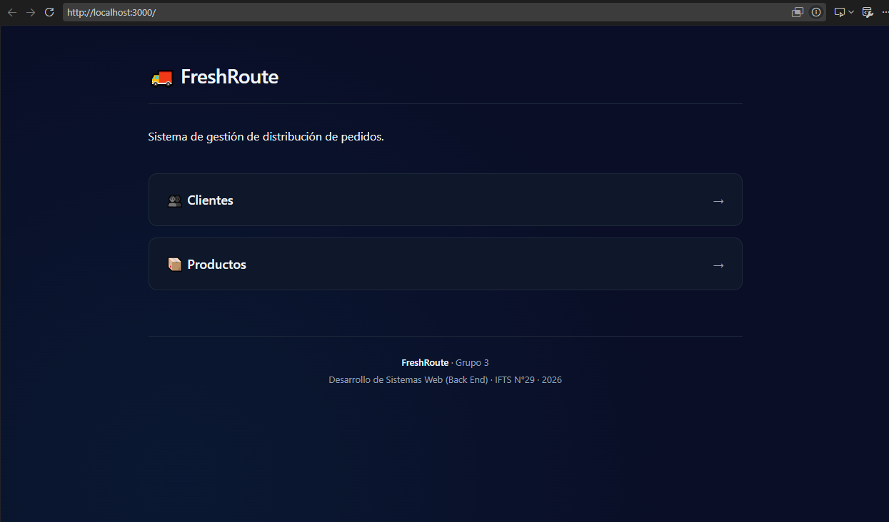

**Lista de clientes**

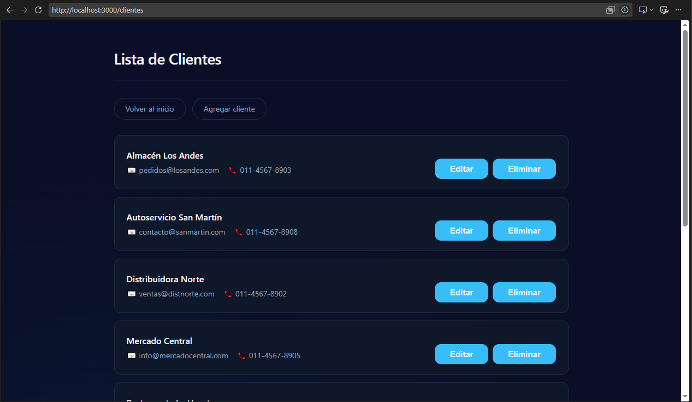

**Lista de productos**

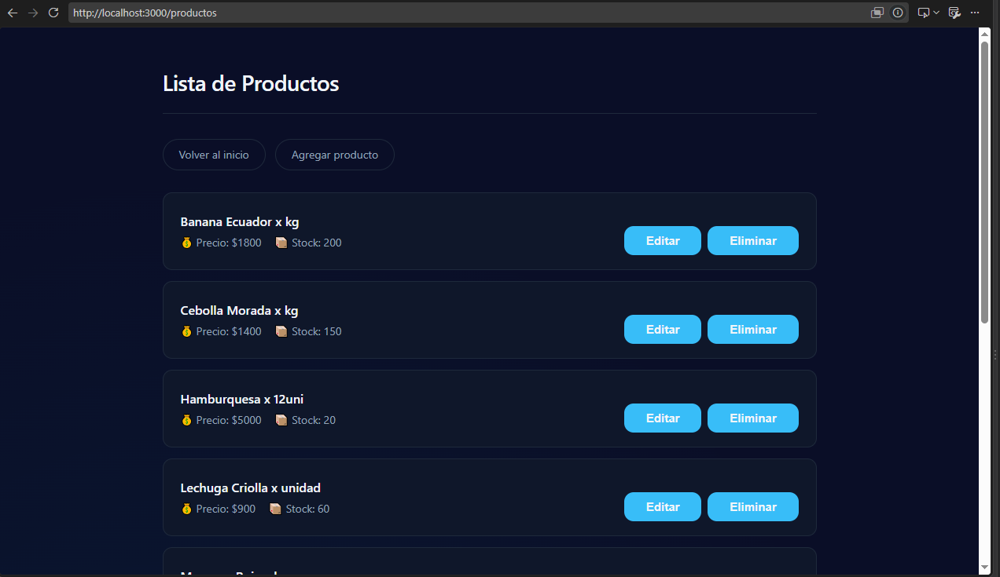

**Formulario de creación de cliente**

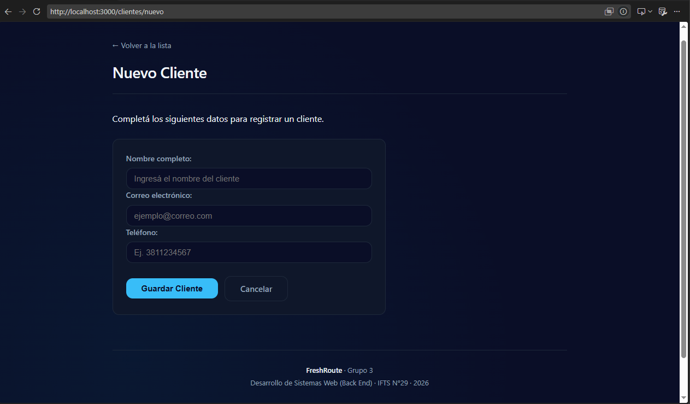

---

## 👥 Integrantes y roles

| Integrante | Usuario GitHub | Rol / Responsabilidades |
|---|---|---|
| Sergio Cesar Barrientos | @SergioCesarBarrientos | Esqueleto del proyecto, desarrollo del cliente, instalación de dependencias |
| Carolina Silva Cotto | @csilvacotto-2202 | Implementación de POC, constructores de Clientes y Productos, persistencia |
| Mariana Sosa | @MaruSosa | Métodos HTTP, funcionalidades de Clientes y Productos, adaptación de endpoints |
| Miguel Angel Marcaida Marquez | @Miguel-Marcaida | Manejo de errores, seed de datos, README, vistas Pug, pruebas |

---

## 🛠️ Tecnologías utilizadas

- **Node.js** — entorno de ejecución
- **Express** — framework web
- **MongoDB Atlas** — base de datos NoSQL en la nube
- **Mongoose** — ODM para MongoDB
- **Pug** — motor de plantillas
- **Nodemon** — reinicio automático en desarrollo
- **dotenv** — variables de entorno

---

## 📁 Estructura del proyecto

```text
FreshRoute---BackEnd/
├── app.js
├── seed.js
├── package.json
├── .env
├── .gitignore
├── docs/
│   └── img/
├── config/
│   └── connectDB.js
├── controllers/
│   ├── clientesController.js
│   └── productosController.js
├── middlewares/
│   ├── logger.js
│   └── errorHandler.js
├── models/
│   ├── Cliente.js
│   └── Producto.js
├── routes/
│   ├── clientesRoutes.js
│   └── productosRoutes.js
├── utils/
│   └── AppError.js
├── public/
│   └── css/
│       └── styles.css
└── views/
    ├── layout.pug
    ├── index.pug
    ├── clientes/
    └── productos/

```
 ---

## ⚙️ Instalación y uso

**1) Clonar el repositorio**

git clone https://github.com/SergioCesarBarrientos/FreshRoute---BackEnd.git
cd FreshRoute---BackEnd

**2) Instalar dependencias**

npm install

**3) Configurar variables de entorno**

Crear un archivo `.env` en la raíz con:

MONGO_URI=mongodb+srv://<usuario>:<password>@<cluster>.mongodb.net/freshroute
PORT=3000

**4) Precargar datos de prueba (opcional)**

node seed.js

Esto borra los datos actuales e inserta 8 clientes y 8 productos de ejemplo.

**5) Iniciar el servidor**

npm run dev

La aplicación queda disponible en http://localhost:3000   

---

## 🔗 Endpoints de la API

### Clientes

- **GET** `/api/clientes` — Obtener todos los clientes
- **GET** `/api/clientes/:id` — Obtener un cliente por ID
- **POST** `/api/clientes` — Crear un cliente
- **PUT** `/api/clientes/:id` — Actualizar un cliente
- **DELETE** `/api/clientes/:id` — Eliminar un cliente

### Productos

- **GET** `/api/productos` — Obtener todos los productos
- **GET** `/api/productos/:id` — Obtener un producto por ID
- **POST** `/api/productos` — Crear un producto
- **PUT** `/api/productos/:id` — Actualizar un producto
- **DELETE** `/api/productos/:id` — Eliminar un producto

### Vistas (Pug)

- `/` — Página principal
- `/clientes` — Lista de clientes
- `/clientes/nuevo` — Formulario de creación
- `/clientes/editar/:id` — Formulario de edición
- `/productos` — Lista de productos
- `/productos/nuevo` — Formulario de creación
- `/productos/editar/:id` — Formulario de edición

---

### Pruebas de la API

**POST — Crear cliente (201 Created)**

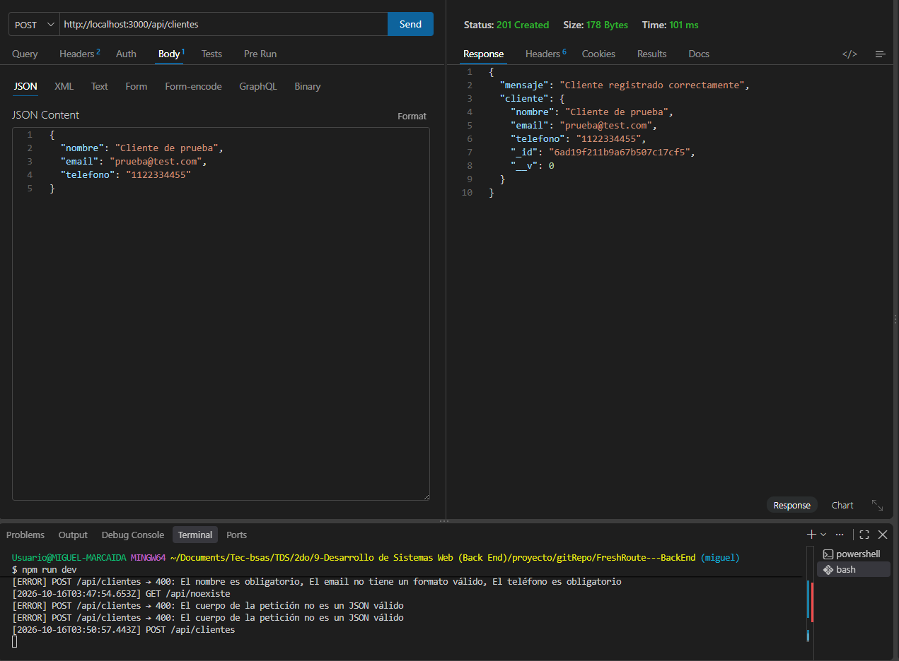

**GET — Listar clientes (200 OK)**

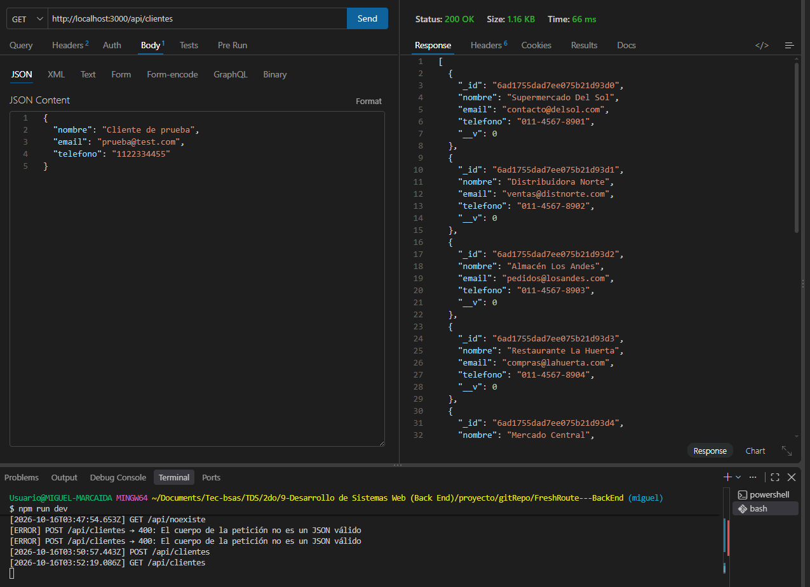

---

## 🛠️ Manejo de errores

El proyecto implementa un **middleware central de manejo de errores** (middlewares/errorHandler.js) que captura los errores lanzados desde los controladores mediante next(error) y devuelve respuestas consistentes en formato JSON.

### Clase AppError

Los errores personalizados se lanzan con la clase AppError (utils/AppError.js):

throw new AppError("Cliente no encontrado", 404);

### Códigos de error manejados

- **400** — ID inválido (ObjectId mal formado)
- **400** — Validación de Mongoose (campos obligatorios, formato)
- **400** — JSON malformado en el body de la petición
- **400** — Clave duplicada
- **404** — Recurso no encontrado
- **404** — Ruta inexistente
- **500** — Error interno del servidor

### Evidencia de manejo de errores

**400 — ID inválido**

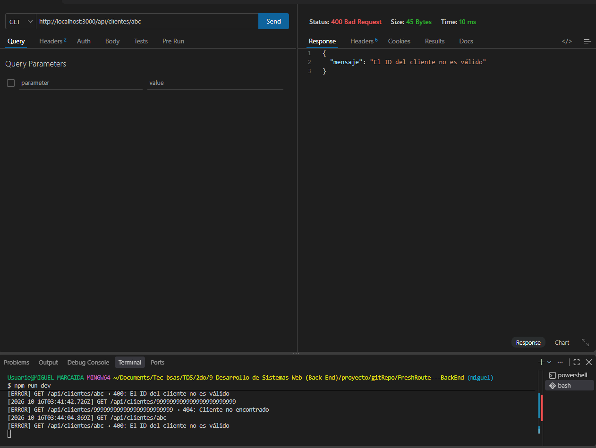

**404 — Cliente no encontrado**

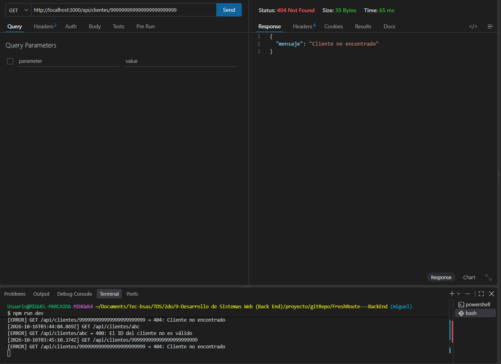

**400 — Validación de Mongoose**

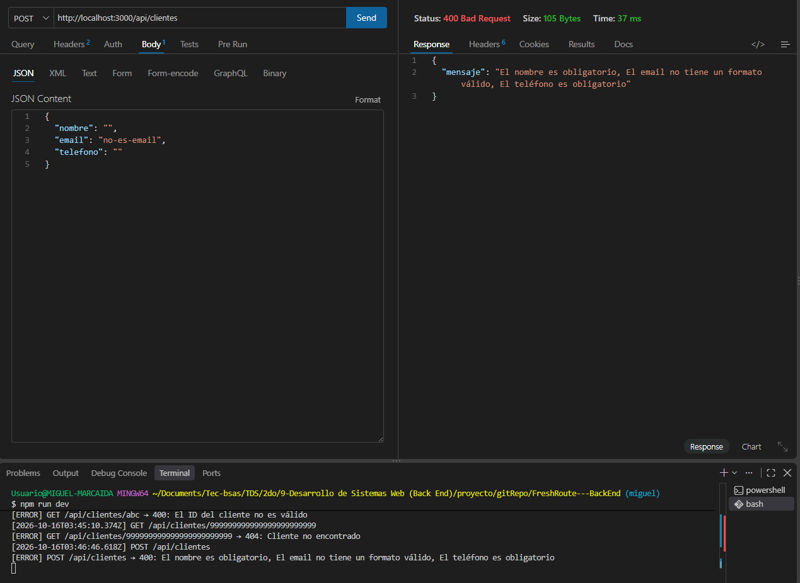

**404 — Ruta inexistente**

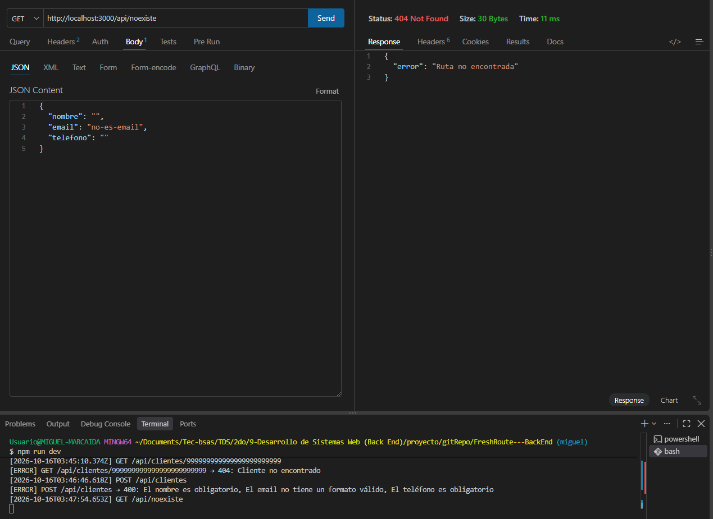

**400 — JSON malformado**

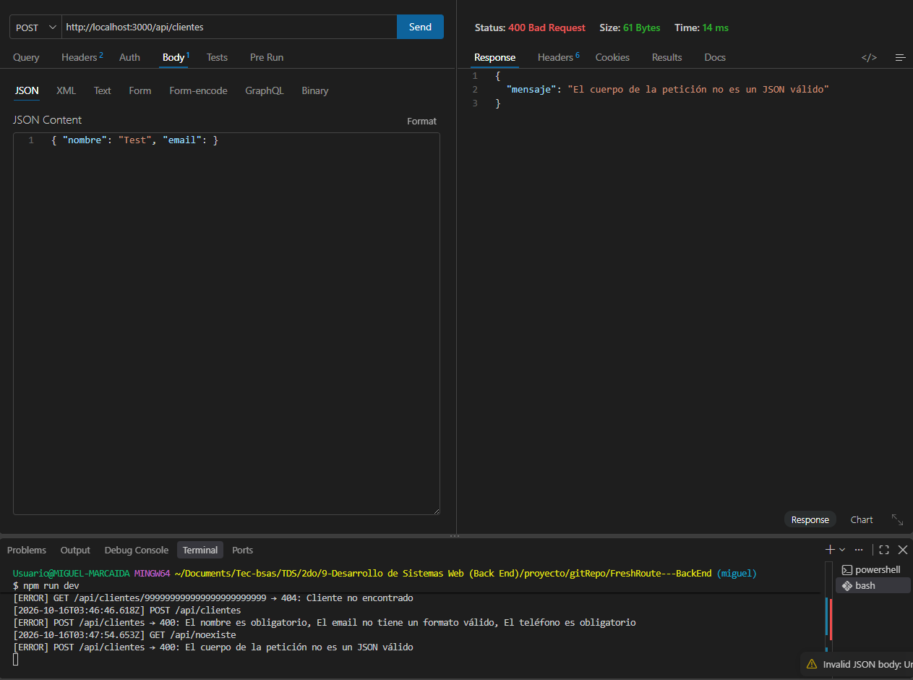

---

## 🗄️ Base de datos

El proyecto utiliza **MongoDB Atlas** con las colecciones `clientes` y `productos`.

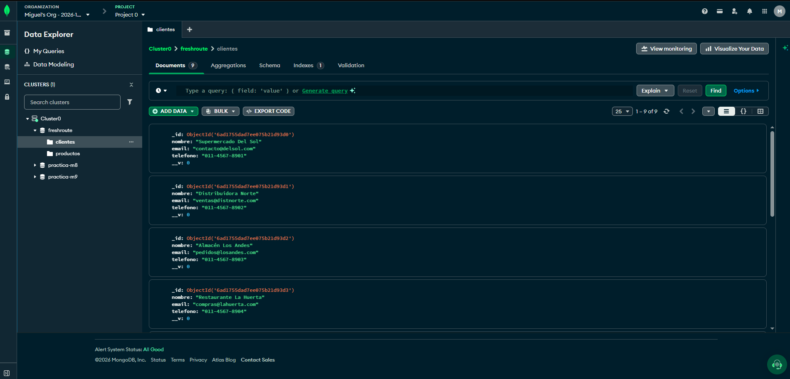

---

## 🤖 Uso de Inteligencia Artificial

Durante el desarrollo del proyecto se utilizaron herramientas de Inteligencia Artificial como apoyo en distintas etapas del trabajo.

**Herramientas utilizadas por el equipo:**

- **DeepSeek** — asistencia técnica, debugging, generación de código base y documentación
- **ChatGPT** — asistencia durante el desarrollo
- **Gemini** — asistencia durante el desarrollo

**Áreas donde se aplicó IA:**

- Comprensión de conceptos (Mongoose, async/await, middlewares)
- Generación de boilerplate y estructura inicial de archivos
- Debugging y resolución de errores
- Redacción y mejora de documentación

**Nota:** cada integrante utilizó las herramientas según sus necesidades durante el desarrollo. Todas las sugerencias generadas por IA fueron revisadas, adaptadas y validadas por el equipo antes de incorporarlas al proyecto. Las decisiones de arquitectura y lógica de negocio fueron tomadas por los integrantes.

---

## 📚 Bibliografía

### Material de cátedra

- **Módulo 1** — Fundamentos de Backend
- **Módulo 2** — Conociendo el entorno
- **Módulo 3** — Modelado de estructuras
- **Módulo 4** — Módulos en Node.js
- **Módulo 5** — Marco de desarrollo
- **Módulo 6** — Asincronismo Web
- **Módulo 7** — API REST básica con Node y Express
- **Módulo 8** — Estructura de documentos (NoSQL)
- **Módulo 9** — Creación de una API REST completa

### Documentación oficial

- Node.js — https://nodejs.org/docs/
- Express — https://expressjs.com/
- MongoDB — https://www.mongodb.com/docs/
- Mongoose — https://mongoosejs.com/docs/
- Pug — https://pugjs.org/

---

## 🔗 Enlaces del proyecto

- **Repositorio GitHub:** https://github.com/SergioCesarBarrientos/FreshRoute---BackEnd
- **Google Drive:** https://drive.google.com/drive/folders/1Boq0lor7hL8UX8I1mGAfGmOw5_cZ_Dov?usp=drive_link
- **Video explicativo:** [Ver video](https://drive.google.com/file/d/16I1qHDy02iNcNwicMFBFgPCjPvIYirWy/view?usp=drive_link)